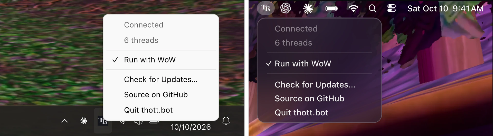
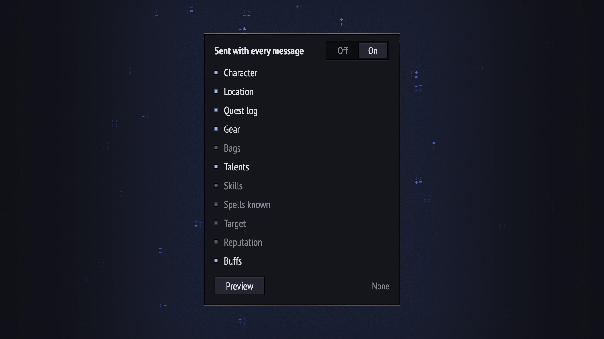

<div align="center">

<picture>
  <source media="(prefers-color-scheme: dark)" srcset=".github/media/mark-dark.svg">
  
</picture>

# thott.bot chat

**Bring your AI into Azeroth.**<br>
Ask Codex or Claude Code anything without leaving the game.

[](https://github.com/thott-bot/chat/releases/latest)
[](LICENSE)
[](#get-started)

<a href="https://thott.bot/addon"></a>

**[Download for Windows](https://github.com/thott-bot/chat/releases/latest/download/thott.bot-chat-Windows.zip)** · **[Download for macOS](https://github.com/thott-bot/chat/releases/latest/download/thott.bot-chat-macOS.zip)** · **[thott.bot MCP](https://thott.bot/ai)**

</div>

---

thott.bot chat brings Codex and Claude Code into WoW Forever. Check on a refactor between pulls, ask what last
night's hotfix changed for your character, or ship the fix your team is waiting on from the flight path. With the
thott.bot MCP, every answer about the game and your character is current to the minute.

## How it works

Other AI addons make you `/reload` after every message or read your screen. thott.bot chat does neither.

A tiny sidecar app does the talking. It sits in your menu bar or system tray and talks to your signed-in Codex CLI or
Claude Code CLI, passing messages to and from the game live. Nothing reads your screen or the game's memory.



Yes, those are 256 tiny thott.bot chat helpers in your AddOns list. The app reads and writes through them, so nothing reads
your screen and you never reload after every message. It looks kind of ugly, but collapse the group once and you'll
never have to think about it.

The download is under 7 MB, and the app uses about 50 MB of memory and next to no CPU. It sends no telemetry and opens
no network port. Turn on **Run with WoW** and it opens and quits with the game.

## Better with thott.bot

On its own, your AI is always out of date on WoW Forever. It fills the gaps with haphazard web searches. Connect the
thott.bot MCP and it stays current to the minute, with every build, hotfix and blue post straight from the game's own
files.

Switch on your gear, talents, bags, quests, reputation or anything else you want your AI to know, and its answers are
about your character, not a generic one. Ask what last night's hotfix did to your spec, the fastest way to level your
professions, or which bosses drop the best upgrades for you. Every item, spell and talent in its answer opens as
a real tooltip in game.



To connect Claude Code:

```sh
claude mcp add --transport http --scope user thott https://mcp.thott.bot/mcp
```

To connect Codex:

```sh
codex mcp add thott --url https://mcp.thott.bot/mcp
```

Or if you're feeling lazy, paste this and let your AI do it:

```text
Set up thott.bot so you can answer my WoW Forever questions. Here's how: https://thott.bot/llms.txt
```

Connecting is free, and it works with any AI that supports MCP, including ChatGPT and Claude:
[thott.bot/ai](https://thott.bot/ai).

## Get started

You need WoW Forever on a Windows PC or a Mac with macOS 12 Monterey or later, and the
[Codex CLI](https://learn.chatgpt.com/docs/codex/cli) or the [Claude Code CLI](https://code.claude.com/docs/en/setup)
installed and signed in on the same computer. The ChatGPT and Claude desktop apps don't count, because other programs
can't use the copies of Codex and Claude Code inside them.

Unzip the download, open thott.bot chat, then type `/tb` in game or click the TB icon on the minimap to start a
conversation. If WoW is open, restart it so the addon loads. The app lives in the system tray on Windows and in the
menu bar on a Mac.

The app isn't signed by Apple or Microsoft yet, so your computer warns you the first time you open it. On Windows,
choose **More info** and then **Run anyway**. On a Mac, allow it once in **System Settings › Privacy & Security**. If
you have any concerns, all of its code is in this repository.

## Questions

<details>
<summary><b>Can the addon get me banned?</b></summary>

No. The addon does nothing Blizzard's addon policy doesn't allow, and nothing reads your screen or the game's memory.

</details>
<details>
<summary><b>What does my AI see about my character?</b></summary>

Only the parts you switch on, and everything starts off. **Preview** in the game shows exactly what goes with your
message.

</details>
<details>
<summary><b>Does the app ever act for me?</b></summary>

No. Every request from your AI waits in the game until you choose **Allow** or **Deny**. If you quit the app or WoW,
your AI finishes its current task on its own, as it would if you closed a terminal.

</details>
<details>
<summary><b>What does it cost?</b></summary>

The addon and its app are free and need no account. Your AI runs on your own OpenAI or Anthropic plan, the same as it
does in a terminal. The thott.bot MCP is free for about 30 questions a month, and
[Unlimited](https://thott.bot/plans) has no monthly limit.

</details>
<details>
<summary><b>What does the app send over the internet?</b></summary>

Its only requests of its own go to GitHub, to check for a new release and download it. It never asks for a password or
an API key, and its log never records what you asked or what your AI answered.

</details>
<details>
<summary><b>How do I update?</b></summary>

Updates install themselves. The app downloads each new release and checks it against the checksum GitHub lists, then
installs it the next time WoW is closed. To update right away, choose **Install and Restart** in the app's menu.

</details>
<details>
<summary><b>How do I check a download?</b></summary>

GitHub builds each release from this source and records an attestation for each ZIP. With the
[GitHub CLI](https://cli.github.com), run `gh attestation verify thott.bot-chat-Windows.zip --repo thott-bot/chat`, or the
same command with `thott.bot-chat-macOS.zip`.

</details>

## Help

To report a problem, open an issue in this repository.
To report a security problem privately, email support@thott.bot.

## Build and test

From this folder, with Go 1.26.9 or newer and Lua:

```text
go vet ./... && go test -race ./...
lua test/run.lua          # the addon, headless, against the samples
go run ./helper           # the thott.bot chat app
```

The app runs the Codex CLI or the Claude Code CLI as a child process and opens no network port.
Any addon in the game can send the same messages as thott.bot chat, so the permission settings of your Codex CLI or Claude
Code CLI decide what your AI may do.

## License

Copyright (C) 2026 Eden Blue Ventures LLC

The code is free software under the GNU General Public License, version 3 only ([LICENSE](LICENSE)).
The PT Sans fonts in the addon's `Media` folder keep their own license.
The license covers the code but not the thott.bot name or logo, so a fork must use its own name and art.

Not affiliated with Blizzard Entertainment, Wowhead, ZAM or the original Thottbot.
